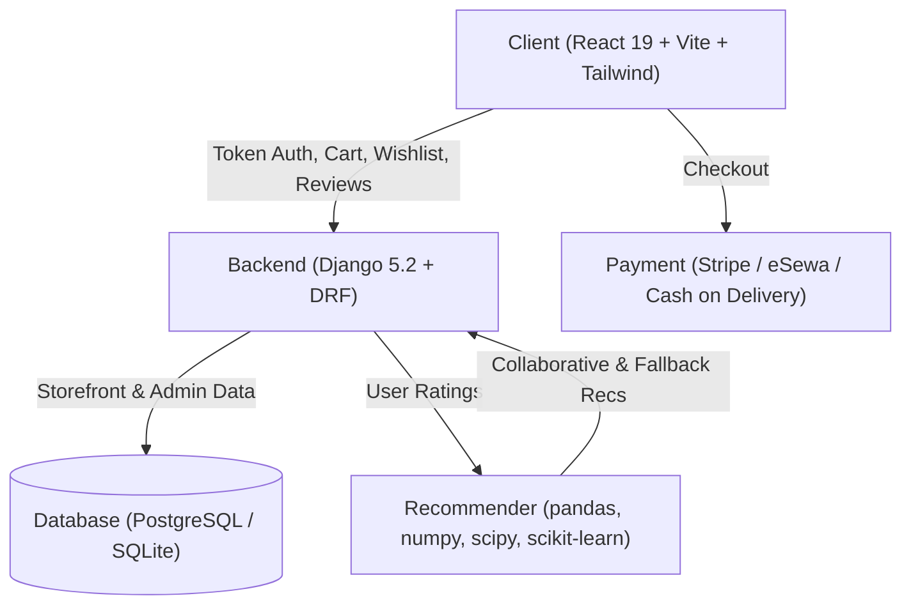
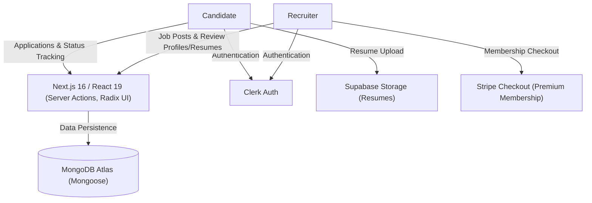
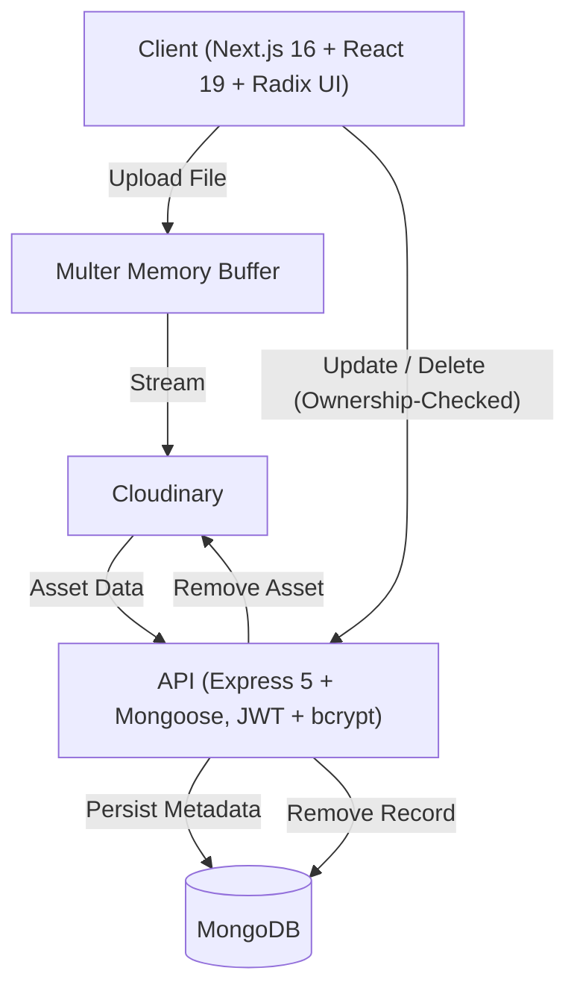

# Nirajan Tiwari

**Full-Stack Developer** at Cherdung Info Tech · Kathmandu, Nepal  
`React · Next.js · TypeScript · Django / DRF`

  
  
  
  

### About

  

  

## Projects

<!-- BookRecommendationSystem -->

  <picture>
    <source media="(prefers-color-scheme: dark)" srcset="assets/projects/book-recommendation-system-dark.svg">
    <source media="(prefers-color-scheme: light)" srcset="assets/projects/book-recommendation-system-light.svg">
    
  </picture>

  
  
  
  
  

<b>Architecture &amp; Specs</b>

- **Hybrid Recommender**: User-based + item-based collaborative filtering with popular-books fallback (`pandas`, `numpy`, `scipy`, `scikit-learn`).
- **Storefront & Checkout**: Token auth, cart, wishlist, reviews, and Stripe / eSewa / cash-on-delivery payments.
- **Admin Dashboard**: Sales, revenue, best sellers, and low-stock alerts (SQLite in dev, PostgreSQL in prod).

 

<!-- JobVista -->

  <picture>
    <source media="(prefers-color-scheme: dark)" srcset="assets/projects/job-vista-dark.svg">
    <source media="(prefers-color-scheme: light)" srcset="assets/projects/job-vista-light.svg">
    
  </picture>

  
  
  
  
  

<b>Architecture &amp; Specs</b>

- **Dual Roles**: Candidate & recruiter onboarding, job filters, applications, status tracking, and profile/resume review.
- **Monetization & Storage**: Posting limits tied to Stripe membership tiers and Supabase Storage for resumes.
- **Core Stack**: Next.js 16 / React 19 server actions, Radix UI, Clerk auth, and MongoDB Atlas via Mongoose.

 

<!-- Pixify -->

  <picture>
    <source media="(prefers-color-scheme: dark)" srcset="assets/projects/pixify-dark.svg">
    <source media="(prefers-color-scheme: light)" srcset="assets/projects/pixify-light.svg">
    
  </picture>

  
  
  
  
  

<b>Architecture &amp; Specs</b>

- **Decoupled Media Pipeline**: Next.js 16 / Tailwind v4 frontend paired with an Express 5 / Mongoose REST API.
- **Direct Streaming & Auth**: JWT + bcrypt auth, Multer memory-buffered uploads streamed to Cloudinary, and ownership-checked cascading asset deletion.
- **Galleries**: Paginated community and per-user galleries with Radix UI dialogs.

  

### Stack

  

  

### Activity

<picture>
  <source media="(prefers-color-scheme: dark)" srcset="https://raw.githubusercontent.com/Nirajan09/Nirajan09/output/github-contribution-grid-snake-dark.svg">
  <source media="(prefers-color-scheme: light)" srcset="https://raw.githubusercontent.com/Nirajan09/Nirajan09/output/github-contribution-grid-snake.svg">
  
</picture>

  

<picture>
  <source media="(prefers-color-scheme: dark)" srcset="https://raw.githubusercontent.com/Nirajan09/Nirajan09/metrics/github-metrics-dark.svg">
  <source media="(prefers-color-scheme: light)" srcset="https://raw.githubusercontent.com/Nirajan09/Nirajan09/metrics/github-metrics-light.svg">
  
</picture>

  

<picture>
  <source media="(prefers-color-scheme: dark)" srcset="https://streak-stats.demolab.com/?user=Nirajan09&theme=tokyonight&hide_border=true&background=080C14&ring=00F2FE&fire=F59E0B&currStreakLabel=00F2FE&currStreakNum=F8FAFC">
  <source media="(prefers-color-scheme: light)" srcset="https://streak-stats.demolab.com/?user=Nirajan09&theme=default&hide_border=true&background=F8FAFC&ring=0284C7&fire=D97706&currStreakLabel=0284C7&currStreakNum=0F172A">
  
</picture>

<b>3D Contribution Skyline</b>

  <picture>
    <source media="(prefers-color-scheme: dark)" srcset="https://raw.githubusercontent.com/Nirajan09/Nirajan09/profile-3d-contrib/profile-night-rainbow.svg">
    <source media="(prefers-color-scheme: light)" srcset="https://raw.githubusercontent.com/Nirajan09/Nirajan09/profile-3d-contrib/profile-gitblock.svg">
    
  </picture>

  

  Nirajan Tiwari · Kathmandu, Nepal

