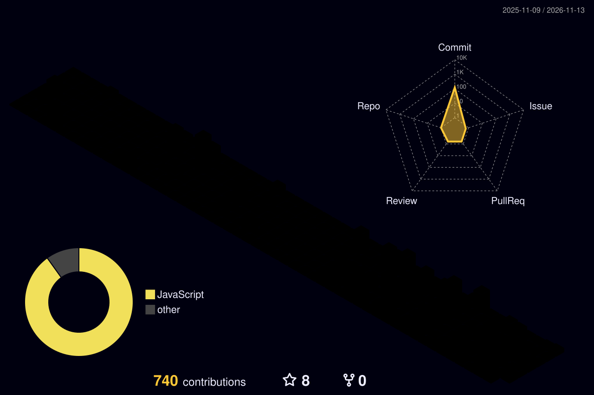
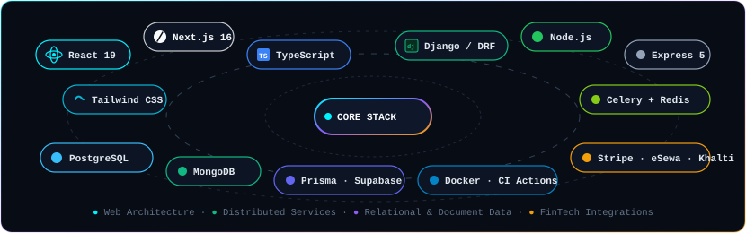
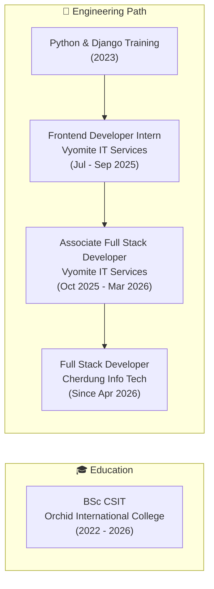
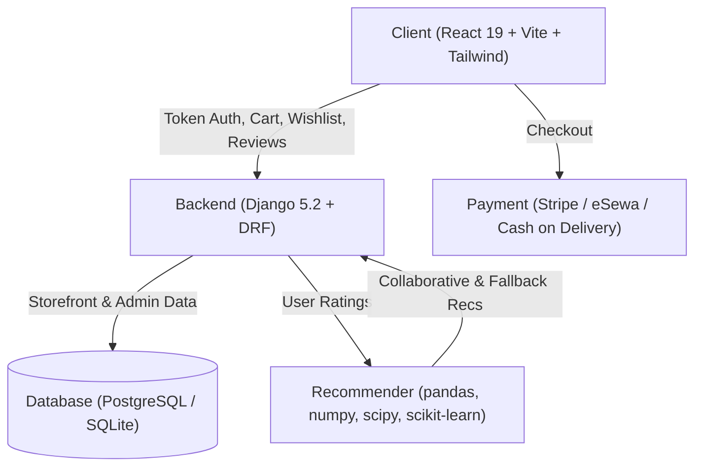
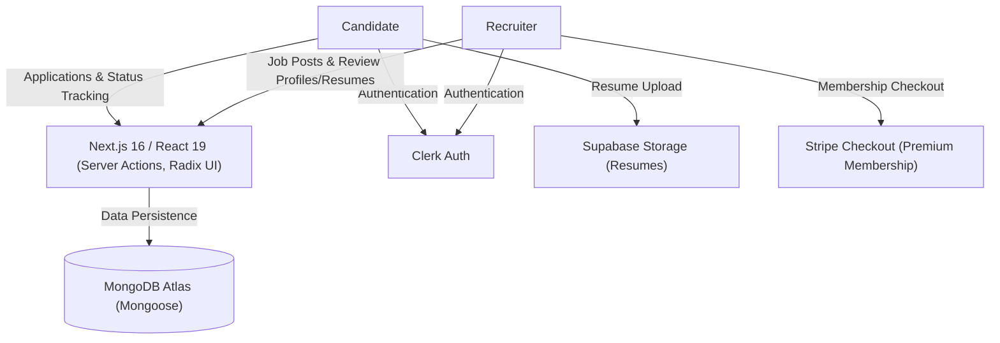
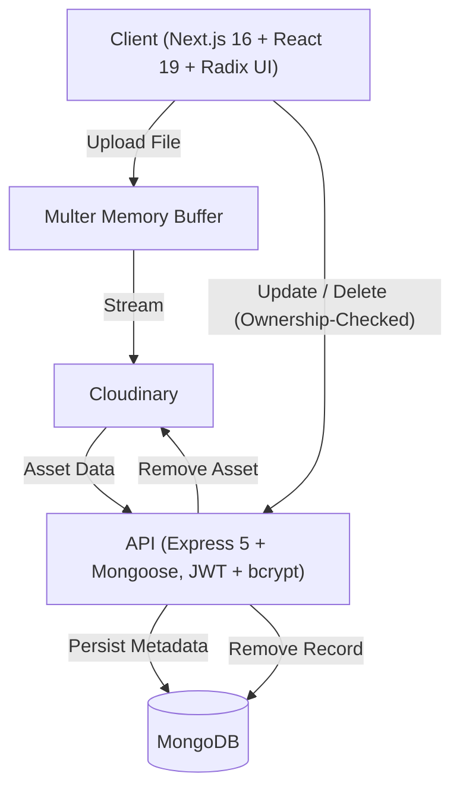

<div align="center">

<!-- Hero Banner (capsule-render custom-gradient) -->


<!-- Hero Animated Typing SVG -->
<picture>
  <source media="(prefers-color-scheme: dark)" srcset="https://readme-typing-svg.demolab.com?font=Fira+Code&weight=600&size=20&duration=3000&pause=1000&color=00F2FE&center=true&vCenter=true&width=620&height=45&lines=Full-Stack+%26+Full+of+Coffee;React+%7C+Next.js+%7C+Django+%7C+TypeScript;From+Schema+Design+to+Production;Kathmandu%2C+Nepal">
  <source media="(prefers-color-scheme: light)" srcset="https://readme-typing-svg.demolab.com?font=Fira+Code&weight=600&size=20&duration=3000&pause=1000&color=0284C7&center=true&vCenter=true&width=620&height=45&lines=Full-Stack+%26+Full+of+Coffee;React+%7C+Next.js+%7C+Django+%7C+TypeScript;From+Schema+Design+to+Production;Kathmandu%2C+Nepal">
  
</picture>

<!-- Currently Strip -->
<p align="center">
  
  
  
</p>

<!-- Action Buttons -->
<p align="center">
  <a href="https://nirajantiwari.com.np"></a>
  <a href="https://github.com/Nirajan09"></a>
  <a href="https://www.linkedin.com/in/nirajan-tiwari"></a>
  <a href="mailto:nirajantiwari09@gmail.com"></a>
</p>

```typescript
const engineer = {
  name: "Nirajan Tiwari",
  base: "Kathmandu, Nepal",
  currentRole: "Full Stack Developer @ Cherdung Info Tech",
  focus: ["React", "Next.js", "Django", "TypeScript"],
  rule: () => { try { ship(); } catch { blame("cache"); } }
};
```

</div>

<div align="center">
  
</div>

### 📡 System Telemetry &amp; Activity

<div align="center">

<!-- 3D Contribution Skyline -->
<picture>
  <source media="(prefers-color-scheme: dark)" srcset="https://raw.githubusercontent.com/Nirajan09/Nirajan09/profile-3d-contrib/profile-night-rainbow.svg">
  <source media="(prefers-color-scheme: light)" srcset="https://raw.githubusercontent.com/Nirajan09/Nirajan09/profile-3d-contrib/profile-gitblock.svg">
  
</picture>

<br><br>

<!-- Platane Snake -->
<picture>
  <source media="(prefers-color-scheme: dark)" srcset="https://raw.githubusercontent.com/Nirajan09/Nirajan09/output/github-contribution-grid-snake-dark.svg">
  <source media="(prefers-color-scheme: light)" srcset="https://raw.githubusercontent.com/Nirajan09/Nirajan09/output/github-contribution-grid-snake.svg">
  
</picture>

</div>

<div align="center">
  
</div>

### 💻 $ whoami --verbose

<div align="center">
  
</div>

<div align="center">
  
</div>

### 🛠️ $ ls -la ~/stack

<div align="center">
  
</div>

<br>

| Domain | Technologies &amp; Infrastructure |
| :--- | :--- |
| **Frontend** | React 19, Next.js 16, TypeScript, Tailwind CSS, Radix UI |
| **Backend &amp; Services** | Django 5.2 / DRF, Node.js, Express 5, Celery, Redis |
| **Data &amp; Storage** | PostgreSQL, MongoDB, Prisma ORM, Supabase Storage |
| **DevOps &amp; Pipeline** | Docker, Docker Compose, GitHub Actions, Nginx |
| **Integrations** | Stripe, eSewa, Khalti, Clerk, Cloudinary |

<div align="center">
  
</div>

### 📈 $ git log --oneline --graph



<div align="center">
  
</div>

## 🚀 $ ls ~/projects --featured

<!-- ========================================================================= -->
<!-- PROJECT 01: BookRecommendationSystem -->
<!-- ========================================================================= -->
### 01 // BookRecommendationSystem

<div align="center">
  <picture>
    <source media="(prefers-color-scheme: dark)" srcset="assets/projects/book-recommendation-system-dark.svg">
    <source media="(prefers-color-scheme: light)" srcset="assets/projects/book-recommendation-system-light.svg">
    
  </picture>
</div>

<p align="center">
  <a href="https://book-recommendation-system-umber.vercel.app/"></a>
  <a href="https://github.com/Nirajan09/BookRecommendationSystem"></a>
  
  
  
</p>

<!-- TODO: Add demo preview GIF at assets/screens/book-recommendation-system.gif -->

<details>
<summary><b>🔍 Under the hood: Architecture &amp; System Specs</b></summary>



- **Hybrid Recommender Engine**: Combines user-based and item-based collaborative filtering with a popular-books fallback (pandas, numpy, scipy, scikit-learn).
- **Storefront Features**: Token authentication, cart, wishlist, and ratings/reviews.
- **Checkout Integrations**: Payment support for Stripe, eSewa, and cash-on-delivery.
- **Admin Dashboard**: Sales, revenue, best sellers, and low-stock alerts.
- **Environments**: SQLite in development, PostgreSQL in production.

<!-- TODO: Add the hardest technical challenge solved for BookRecommendationSystem -->

</details>

<br>

<!-- ========================================================================= -->
<!-- PROJECT 02: JobVista -->
<!-- ========================================================================= -->
### 02 // JobVista

<div align="center">
  <picture>
    <source media="(prefers-color-scheme: dark)" srcset="assets/projects/job-vista-dark.svg">
    <source media="(prefers-color-scheme: light)" srcset="assets/projects/job-vista-light.svg">
    
  </picture>
</div>

<p align="center">
  <a href="https://job-portal-liard-one.vercel.app/"></a>
  <a href="https://github.com/Nirajan09/job-portal"></a>
  
  
  
</p>

<!-- TODO: Add demo preview GIF at assets/screens/job-vista.gif -->

<details>
<summary><b>🔍 Under the hood: Architecture &amp; System Specs</b></summary>



- **Dual-Role Workflows**: Candidate and recruiter roles with dedicated onboarding flows.
- **Job Posting & Membership**: Job posting with limits tied to membership, powered by Stripe checkout.
- **Search & Application Pipeline**: Filters, applications, and application status tracking.
- **Recruiter Review Workspace**: Recruiter review of candidate profiles and resumes.
- **Core Integrations**: Clerk authentication, MongoDB Atlas via Mongoose, and Supabase Storage for resumes.

<!-- TODO: Add the hardest technical challenge solved for JobVista -->

</details>

<br>

<!-- ========================================================================= -->
<!-- PROJECT 03: Pixify -->
<!-- ========================================================================= -->
### 03 // Pixify

<div align="center">
  <picture>
    <source media="(prefers-color-scheme: dark)" srcset="assets/projects/pixify-dark.svg">
    <source media="(prefers-color-scheme: light)" srcset="assets/projects/pixify-light.svg">
    
  </picture>
</div>

<p align="center">
  <a href="https://image-sharing-platform-two.vercel.app/"></a>
  <a href="https://github.com/Nirajan09/image-sharing-platform"></a>
  
  
  
</p>

<!-- TODO: Add demo preview GIF at assets/screens/pixify.gif -->

<details>
<summary><b>🔍 Under the hood: Architecture &amp; System Specs</b></summary>



- **Decoupled Architecture**: Next.js 16 / React 19 / Tailwind v4 frontend consuming an Express 5 / Mongoose REST API.
- **Authentication**: JWT authentication with bcrypt password hashing.
- **Upload Streaming**: Multer memory-buffered uploads streamed directly to Cloudinary.
- **Ownership Verification**: Ownership-checked update and delete operations (which also delete the Cloudinary asset).
- **Galleries & Dialogs**: Paginated community and per-user galleries featuring Radix UI dialogs.

<!-- TODO: Add the hardest technical challenge solved for Pixify -->

</details>

<div align="center">
  
</div>

### 🌐 $ cat ~/.portfolio

<div align="center">

| Portfolio | Stack | URL |
| :--- | :--- | :--- |
| **nirajantiwari.com.np** | Next.js · Tailwind CSS | [https://nirajantiwari.com.np](https://nirajantiwari.com.np) |

</div>

<div align="center">
  
</div>

### 📊 $ curl -s https://api.github.com/users/Nirajan09/stats

<div align="center">

<!-- Self-Hosted GitHub Metrics (Generated via Actions -> metrics branch) -->
<picture>
  <source media="(prefers-color-scheme: dark)" srcset="https://raw.githubusercontent.com/Nirajan09/Nirajan09/metrics/github-metrics-dark.svg">
  <source media="(prefers-color-scheme: light)" srcset="https://raw.githubusercontent.com/Nirajan09/Nirajan09/metrics/github-metrics-light.svg">
  
</picture>

<br><br>

<!-- GitHub Streak Stats -->
<picture>
  <source media="(prefers-color-scheme: dark)" srcset="https://streak-stats.demolab.com/?user=Nirajan09&theme=tokyonight&hide_border=true&background=080C14&ring=00F2FE&fire=F59E0B&currStreakLabel=00F2FE&currStreakNum=F8FAFC">
  <source media="(prefers-color-scheme: light)" srcset="https://streak-stats.demolab.com/?user=Nirajan09&theme=default&hide_border=true&background=F8FAFC&ring=0284C7&fire=D97706&currStreakLabel=0284C7&currStreakNum=0F172A">
  
</picture>

</div>

<div align="center">
  
</div>

### 📬 $ ping -c 1 nirajan

<div align="center">

<p>
  <em>Full-stack engineering from Kathmandu — clean architecture, reliable APIs, and code built to ship. Feel free to explore the repos or connect below.</em>
</p>

<p align="center">
  <a href="https://nirajantiwari.com.np"></a>
  <a href="https://github.com/Nirajan09"></a>
  <a href="https://www.linkedin.com/in/nirajan-tiwari"></a>
  <a href="mailto:nirajantiwari09@gmail.com"></a>
</p>

<sub>Kathmandu, Nepal · UTC+05:45</sub>

</div>
